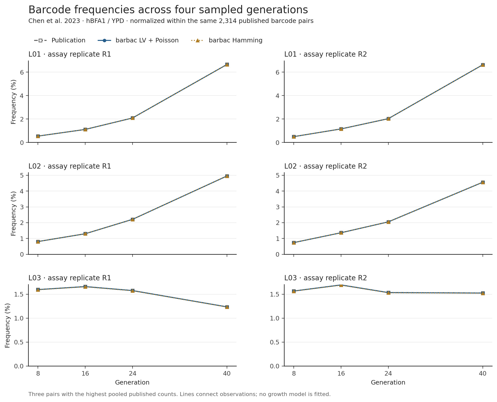

# Supplementary information

**barbac: fast DNA barcode clustering from reads to lineage trajectories**

Loukas Theodosiou, Andrew D. Farr and Paul B. Rainey

## Supplementary Methods: Table 1 settings, provenance and statistical comparisons

Table 1 compares six configurations across two independently simulated library designs and one fixed published simulation. It reports the complete Shepherd sensitivity configuration alongside unchanged results for the other methods.

### Datasets and generation

Random libraries have 20 variable bases. Anchored libraries use NNNNNAANNNNNAANNNNNTTNNNNN (20 variable bases, 26 bases total). Each design contains 60 independent libraries with 10,000 true identities and one million expected reads. Within each seed, the two designs share variable identities and parent abundances. Abundances follow the recorded scaled Johnson exponential mixture (9,989 ordinary, 10 intermediate and one high-abundance identity).

Substitutions occur with probability 0.004 per base. Repeat-dependent indel allocation uses the unscaled archived empirical homopolymer-rate table. Repeat coordinates are updated after events. When a repeat exceeds the measured support (length 13), further indel recursion stops for those reads; reads, origin labels and subsequent substitutions are retained. This boundary affected 249 of 119,992,068 reads across 16 of 120 libraries. All registered seeds and reads remain in the analysis.

The fixed Milo / Johnson deposited simulation contains 100,000 true identities and 24,996,128 reads and was used during development. Its reference counts and origin labels differ at four parents by six reads in total absolute count difference; totals and identities reconcile. Its scores are descriptive. Simulation source: https://pmc.ncbi.nlm.nih.gov/articles/PMC10276077/ ; archived analysis: https://zenodo.org/records/7411747 .

### Configurations

All methods retain an explicit distance limit of 3 and one thread. Barbac uses the preserved v14 native implementation with support ordering, merge ratio 20, configured error proxy 0.005 and design scoring disabled. LV uses the existing Poisson option; Hamming retains its rare-indel rescue. Starcode sphere uses sphere clustering; Starcode MP uses message-passing ratio 5. Bartender uses seed length 5, step 1, cutoff 1, z = 5 and forward direction.

Shepherd uses nominal length, distance 3 and its documented default Bayes-factor threshold −4. It receives the known generating substitution rate 0.004 on every simulated library; the fixed Milo reference uses automatic rate estimation. The earlier frozen configuration used threshold +4 and automatic estimation and failed on ten simulated inputs. The complete supplementary configuration was registered after observing those outcomes. Both changes apply consistently; no accuracy-based parameter search was performed. It supplies the generating substitution rate to Shepherd, not truth identities or repeat-specific indel rates. This is a post hoc sensitivity comparison, not an all-default run or a retroactive replacement for the original confirmatory protocol. Author documentation: https://github.com/Nik-Tavakolian/Shepherd .

### Metrics and timing

Exact-centroid F1 includes all designed truth identities, including those with zero reads. For each library, F1 (%) = 200TP/(2TP + FN + FP). Table entries average library-level accuracy scores without pooling reads across libraries. Read accuracy divides correctly assigned reads by all input reads; incorrect and unassigned reads are both failures. The displayed F1 spread is the sample standard deviation, not a confidence interval.

Runtime measures a fresh Python worker including tool/package startup, required input conversion and canonical centroid/member exports. Common staging, scoring and hashing are excluded. Runs were serial. Original accepted times are retained for all methods other than the new Shepherd configuration, including the previously registered 28 sleep-affected calls repeated once with identical clustering outputs. The 121 supplementary Shepherd calls were timed in a later session; lightweight diagnostic file reads overlapped early calls. No sleep/wake event overlapped those new timed calls. Comparisons involving the new Shepherd times are descriptive. Barbac package startup uses the verified lazy BAM-loading change; its clustering implementation is unchanged.

### Paired accuracy comparisons (Table S1)

The original primary analysis compared Barbac LV with four external configurations in each simulated design, keeping an eight-contrast family. Paired-t one-sided lower bounds use alpha 0.05/8; paired bootstrap lower bounds resample whole libraries 100,000 times at the same level. A positive difference favours Barbac LV. The six complete original contrasts with Bartender and Starcode meet both criteria. The two original Shepherd contrasts remain recorded as unavailable.

For the completed Shepherd sensitivity configuration, the same library pairing and conservative alpha 0.05/8 are retained. These two comparisons remain explicitly post hoc. **Table S1.** The table below combines the six original contrasts and the two supplementary Shepherd contrasts for inspection, with their scope identified. Milo is excluded from population-level inference.

| Design / comparator | LV − comparator F1 (pp) | t lower | Bootstrap lower | Scope |
|---|---:|---:|---:|---|
| Random / Shepherdᵃ | +0.016172 | +0.011819 | +0.012066 | Post hoc |
| Random / Starcode sphere | +0.044684 | +0.033221 | +0.033717 | Original |
| Random / Starcode MP | +0.584555 | +0.559418 | +0.560488 | Original |
| Random / Bartender | +0.149749 | +0.138516 | +0.139150 | Original |
| Anchored / Shepherdᵃ | +0.014868 | +0.009718 | +0.009941 | Post hoc |
| Anchored / Starcode sphere | +0.042949 | +0.030841 | +0.031382 | Original |
| Anchored / Starcode MP | +0.790526 | +0.757208 | +0.759126 | Original |
| Anchored / Bartender | +0.565086 | +0.544386 | +0.545500 | Original |

All displayed summary values were reconciled with 726 execution records. Earlier independent checks reproduced every new Shepherd centroid score, three complete read mappings and the supplementary paired-t calculations in base R. Source fingerprints and the export checks accompany the table in `table_1_provenance.json`.

## Supplementary application: Chen et al. (2023) time series (Table S2, Figure S1)

This archived application comparison predates the final three-benchmark campaign.
Its component-clustering times describe that recorded workflow and are not
relabelled as current-release FASTQ-to-plot times.

We analyzed eight barcode-sequencing samples from the hBFA1 YPD fitness assay
of Chen, Johnson, Hérissant et al. (2023), covering generations 8, 16, 24 and 40
in two biological assay replicates. Of 16,511,755 paired reads, the common
mapping, variable-length barcode extraction and UMI-deduplication workflow
retained 16,051,344 molecules. We pooled each barcode component across the
eight samples for retrospective clustering at distance three and reconstructed
sample-specific paired-barcode counts using a consistent membership map.
Barbac LV with support ordering and the optional Poisson indel model achieved
median Spearman correlation 0.999968 with published counts over
2,314 published pair identifiers; the corresponding Hamming value was
0.999929. Median combined-component clustering workflow times
were 14.65 s and 11.97 s,
respectively, over three serial repeats. These are agreement measurements
against a differently processed experimental reference, not ground-truth
accuracy estimates. Starcode showed slightly higher reference agreement,
while Hamming barbac had the lowest median clustering time (Table S2).
The median proportion of LV molecules assigned to exact published pair IDs
was 83.09%; two abundant absent pairs account for
69.47% of the pooled unmatched mass,
and both have BC2 at least seven edits from every published BC2. Their absence
cannot be attributed to clustering error from this comparison alone.

**Table S2. Publication agreement and clustering workflow time for the Chen 2023 time series.**
Spearman correlations use all 2,314 published pair IDs, filling absent calls with
zero. Molecule coverage is the percentage of method-input molecules assigned to
those exact IDs; both agreement columns are medians across eight samples.
Times are medians of three serial repeats, summing the BC2 and BC1 workflows
including startup and required exports, excluding shared FASTQ preprocessing.
Shepherd uses the supplied error rate 0.005 because automatic estimation failed
on BC1; the value matches the pre-existing barbac configuration and was not
selected using publication agreement. Unassigned totals span all eight samples.

| Method | Median Spearman ρ | Median molecule mass on published pair IDs | Clustering, median seconds | Unassigned molecules, all samples |
|---|---:|---:|---:|---:|
| barbac LV + Poisson | 0.999968 | 83.09% | 14.65 | 0 |
| barbac Hamming | 0.999929 | 82.90% | 11.97 | 0 |
| Shepherd (e=0.005) | 0.930542 | 80.30% | 27.02 | 189,126 |
| Starcode sphere | 0.999991 | 83.13% | 15.74 | 0 |
| Starcode message passing | 0.999990 | 83.14% | 14.84 | 0 |
| Bartender | 0.999931 | 82.93% | 58.48 | 0 |

{width=160mm}

**Figure S1. Barcode frequency trajectories in the Chen et al. (2023) hBFA1 YPD assay.** L01–L03 identify the three barcode pairs with the largest pooled published counts, shown in both biological assay replicates. Frequencies are conditional on the same 2,314 published pair identifiers for the publication and each barbac configuration. Markers denote generations 8, 16, 24 and 40; lines connect measurements without fitting a growth model. Published-pair molecule coverage and unmatched counts are reported separately in the accompanying time-series analysis. Publication agreement is not a ground-truth accuracy measurement.

## Table S3. Development reference: substitution-only and indel-containing designs

**Table S3. Single-library development reference for the random and anchored designs, with and without repeat-dependent indels.** One library per condition (10,000 true identities, one million expected reads, 0.4% substitutions per base; indel conditions use the unscaled archived homopolymer-rate table). These libraries were used during development and are distinct from the 60 final seeds per design in Table 1. Barbac uses the same native v14 implementation and settings as Table 1. Shepherd uses the original frozen configuration (Bayes-factor threshold +4, automatic substitution-rate estimation), which completed on all four inputs; Table 1 reports its completed sensitivity configuration. FN, FP and F1 are exact-centroid metrics including zero-read true identities; read accuracy counts reads assigned to their true parent. Runtime is one fresh-worker observation including startup, conversion and exports, recorded before the 0.2.1 startup change, so these times are not comparable with Table 1. Bold marks the best observed value per metric within a condition. Source: `publication_tables/table_s3_development_reference.csv`, with per-cell receipt signatures.

### Random N20: substitutions only

| Method | FN | FP | F1 (%) | Read accuracy (%) | Workflow s |
|---|---:|---:|---:|---:|---:|
| barbac Hamming | 124 | 22 | 99.26626 | **99.996395** | 6.57 |
| barbac LV + Poisson | 124 | 22 | 99.26626 | **99.996395** | 6.63 |
| Shepherd | 124 | 43 | 99.16160 | 99.994291 | 4.78 |
| Starcode sphere | 120 | **17** | **99.31145** | 99.961643 | 4.95 |
| Starcode MP | **110** | 147 | 98.71737 | 99.985078 | 4.92 |
| Bartender | 124 | 23 | 99.26127 | 99.995593 | **2.85** |

### Random N20: substitutions + repeat-dependent indels

| Method | FN | FP | F1 (%) | Read accuracy (%) | Workflow s |
|---|---:|---:|---:|---:|---:|
| barbac Hamming | 125 | **23** | **99.25621** | **99.996595** | 6.51 |
| barbac LV + Poisson | 125 | **23** | **99.25621** | **99.996595** | 6.99 |
| Shepherd | 128 | 51 | 99.10154 | 99.993190 | 4.80 |
| Starcode sphere | 128 | 25 | 99.23104 | 99.960140 | 5.01 |
| Starcode MP | **115** | 187 | 98.49542 | 99.981172 | 4.95 |
| Bartender | 125 | 53 | 99.10678 | 99.992589 | **3.24** |

### Anchored N20 + AA/TT: substitutions only

| Method | FN | FP | F1 (%) | Read accuracy (%) | Workflow s |
|---|---:|---:|---:|---:|---:|
| barbac Hamming | 119 | **23** | **99.28658** | **99.996695** | 6.71 |
| barbac LV + Poisson | 119 | **23** | **99.28658** | **99.996695** | 6.85 |
| Shepherd | 120 | 24 | 99.27653 | 99.996395 | 13.25 |
| Starcode sphere | 129 | 33 | 99.18609 | 99.975964 | 5.56 |
| Starcode MP | **110** | 201 | 98.45204 | 99.979670 | 5.44 |
| Bartender | 120 | **23** | 99.28152 | 99.996094 | **3.46** |

### Anchored N20 + AA/TT: substitutions + repeat-dependent indels

| Method | FN | FP | F1 (%) | Read accuracy (%) | Workflow s |
|---|---:|---:|---:|---:|---:|
| barbac Hamming | 125 | **27** | **99.23626** | **99.994392** | 6.82 |
| barbac LV + Poisson | 125 | **27** | **99.23626** | **99.994392** | 10.83 |
| Shepherd | 126 | **27** | 99.23119 | 99.993791 | 13.26 |
| Starcode sphere | 126 | **27** | 99.23119 | 99.977066 | 5.72 |
| Starcode MP | **110** | 195 | 98.48145 | 99.980270 | 5.50 |
| Bartender | 125 | 127 | 98.74013 | 99.980070 | **3.53** |

On random substitution-only barcodes Starcode sphere has the highest exact-centroid F1 in this single library, while both barbac configurations have the highest read-assignment accuracy; the 18 positive-read identities missed by Starcode sphere account for 383 misassigned reads, compared with 36 for barbac. On anchored substitution-only barcodes barbac leads F1 and read accuracy. No statistical test is applied to single-library development results.
